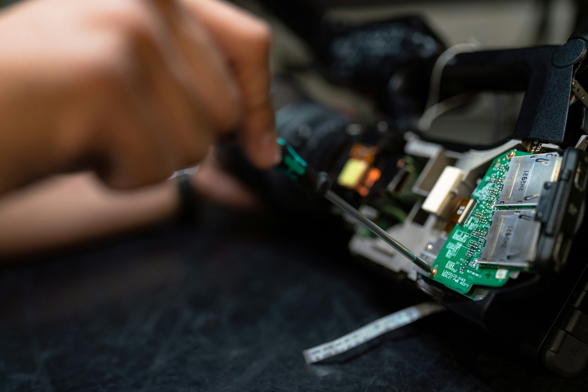
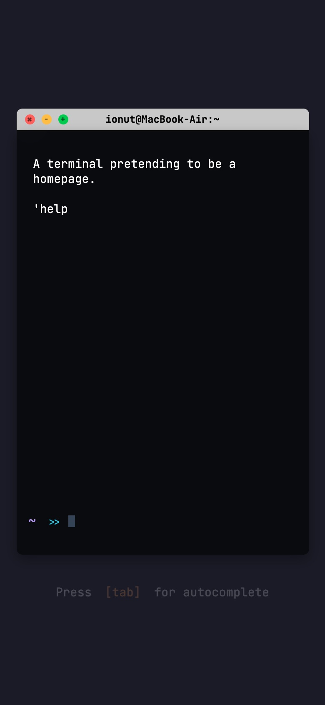

This post is here to check the blog's pages on the real site. Nothing in it is meant to be read, and it will be removed once the layout has been looked at.

A paragraph can have **bold**, *italics*, `inline code`, and [a link back to the homepage](https://ionut.codes/).

## A section heading

Headings come in three sizes. This is the largest one inside a post, and it starts a new section with some space above it.

> A plain quote is shown as a pull quote, set larger than the text around it, for a sentence worth stopping on.

### A smaller heading

A list:

- the first item
- a second item, a little longer than the first so it wraps on a phone screen
- the third item

And a numbered one:

1. open a photo
2. look at the caption band along the bottom
3. close it with the × in the corner


*A landscape photo. On a wide screen it runs wider than the text. Click it to open the viewer. Photo: ThisisEngineering on Unsplash.*

> **3 minutes**
> A number callout: a quote whose first line is only bold text shows that text large, with the rest of the quote beside it.


*A phone screenshot. On a wide screen it sits beside the text; on a phone it stacks like any other photo.*

#### The smallest heading

A few paragraphs to see how the text wraps around the phone screenshot on a wide screen, and how the page reads on a narrow one.

The text column is kept to a comfortable line length, so long paragraphs stay easy to follow even on a large monitor.

A code block:

```
$ node scripts/import-blog.mjs ~/writing
imported 1 post
```

---

That's the end of the test. The cover photo is by ThisisEngineering on Unsplash.
