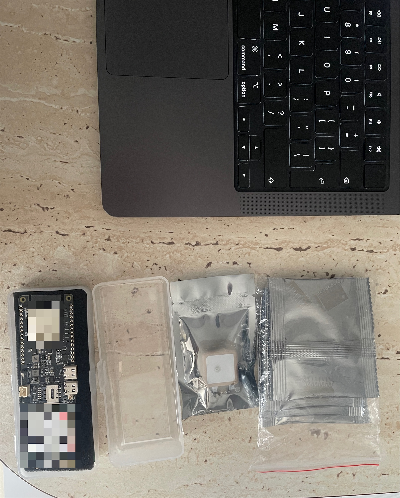
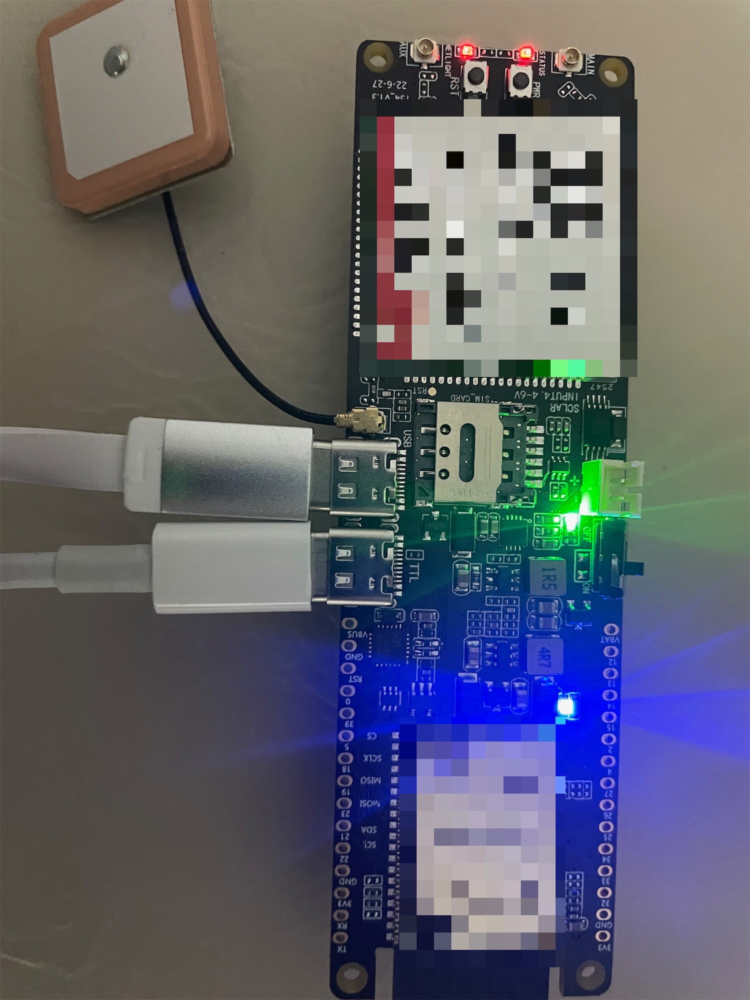
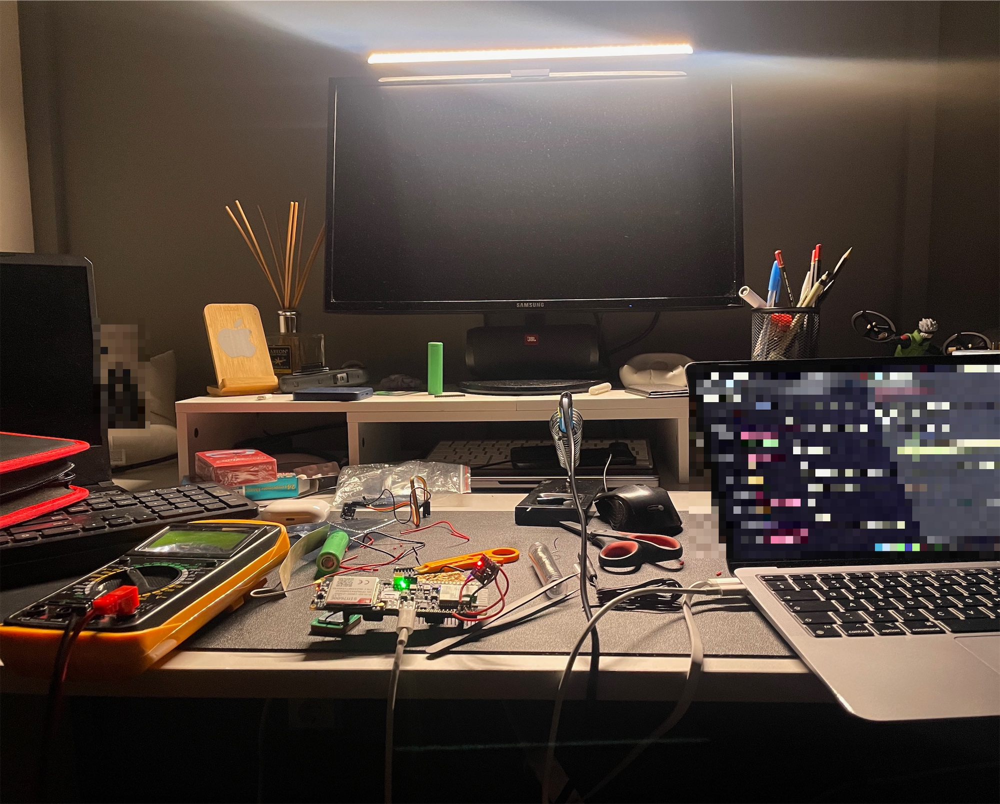
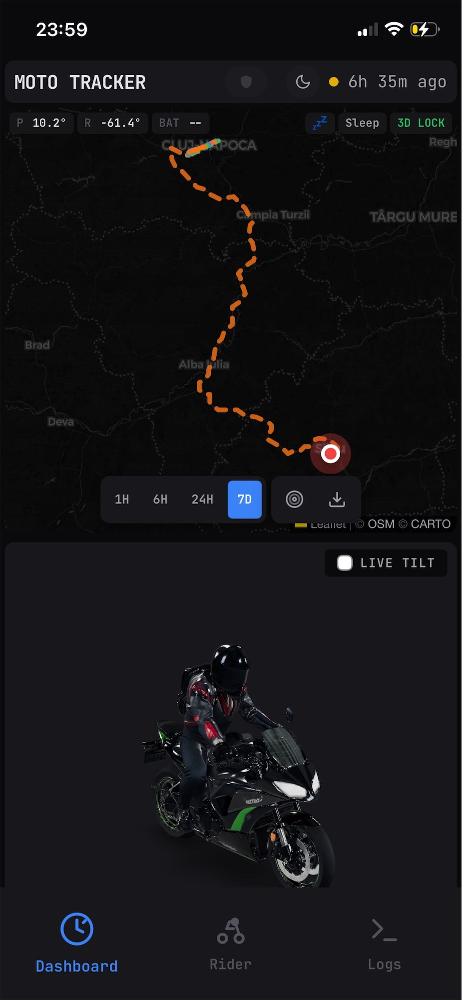
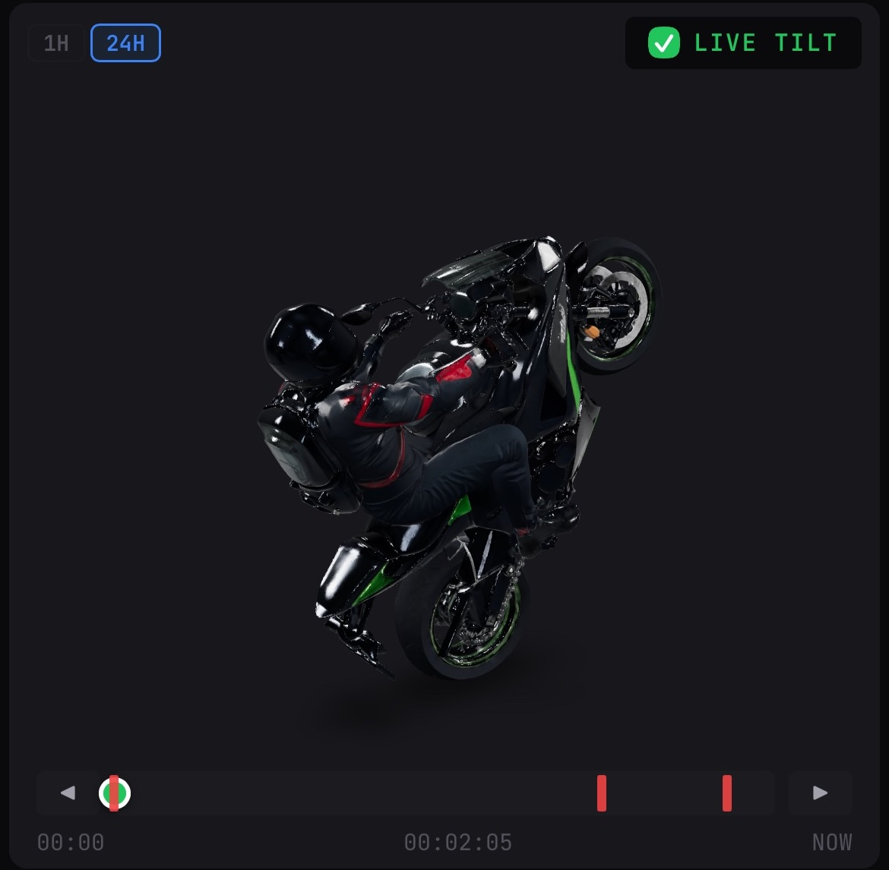

Ever since I started riding motorcycles, one question kept coming back to me: how do I protect my bike when I'm not around?

I started looking into existing security solutions. There were quite a few interesting devices out there: trackers that could report their location, detect movement, and notify you if someone touched or moved your motorcycle.

Exactly what I was looking for.

There was just one problem: the price.

The more I looked into these devices, the more I started wondering whether I could build something similar myself. Not necessarily better, but cheaper, and something I could understand, customize, and build around the way I wanted to use it.

So I decided to give it a try.

## 3 February — The first components

The first step was figuring out what hardware I actually needed.

I started researching components that could work together to provide the functionality I had seen in commercial trackers. Eventually, I settled on an ESP32-based board with GPS and cellular connectivity, together with a motion sensor that could detect the motorcycle's orientation and movement.

A few orders later, the hardware arrived.

The board came out of its box on 3 February 2026, shortly before two in the afternoon. Inside the package were the board itself, a GPS antenna in an antistatic bag, and a handful of smaller components.

*3 February, 13:55. The blurred square is the modem's label, which carries its serial numbers.*

By the evening, the board was already sitting on my desk, powered on, with its little lights blinking.

And that's when the real fun started.

I began soldering. I wasn't particularly confident about that part. I honestly can't remember having successfully soldered anything before. My previous experience involved trying to desolder pins from a Raspberry Pi Pico and ending up with a burned board.

But this time, things seemed to be going in the right direction.

*3 February, 18:42. First power-on.*

## Five days in, four in the morning

Fast-forward five days.

It's Sunday, 8 February, 04:11 in the morning. My desk looks like this:

*8 February, 04:11. A multimeter, battery cells, the board wired to its motion sensor, and the laptop displaying everything the tracker was reporting. The screen is blurred because it showed the exact location of my desk.*

At this point, I had two problems.

The GPS status was stuck on `No Fix`, and the motion sensor kept reporting exactly zero for both pitch and roll.

Zero is actually a perfectly valid reading. It means the motorcycle is level.

But it can also mean the sensor isn't communicating at all.

> At four in the morning, those two possibilities look surprisingly similar.

I spent hours trying to figure out what was wrong. Eventually, I discovered that the motion sensor wasn't soldered properly. It took several attempts, a few questionable moments, and more than one board that I thought I had managed to destroy before I finally got it working.

And then there was the GPS.

It could only get a position when placed near the window. Part of that was simply being indoors: GPS needs a view of the sky. The other part I would only find out a few days later: I had forgotten to connect the cellular antenna. Near the window, both signals were just strong enough to get a position through.

Still, that night felt like a success.

The motion sensor was finally returning actual measurements. After hours of troubleshooting and soldering, I had something working that hadn't worked before.

I went to sleep happy.

The following day, at 17:28 on 9 February, the tracker recorded the oldest GPS position that the application still has in its database.

A small milestone, but an important one.

## The Home Assistant days

During the first two weeks, everything went through Home Assistant, running on a Raspberry Pi at home.

The tracker sent its data there, and Home Assistant handled five automations:

- Notify me when the motorcycle moves while parked.
- Notify me when it leaves home.
- Detect a possible crash.
- Alert me when the tracker goes silent.
- Warn me when its battery gets low.

I also built a dashboard of my own. It read the data from Home Assistant's database and displayed the tracker's position on a map.

It was a pretty good starting point. I could see the motorcycle moving, inspect its data, and receive notifications when something happened.

But I was already thinking about what else I wanted to build.

I wanted more control over the device, more flexibility in how the data was handled, and eventually a proper application that wouldn't depend on my Home Assistant installation.

So I decided to move everything into its own system.

## 17 February — Giving it a home of its own

17 February 2026 is the date of the first commit in the application's repository.

And quite a lot happened that day.

The application got its own database, took over the five automations, learned how to send push notifications directly to my phone, and introduced user accounts so it could support multiple riders and multiple motorcycles.

I also implemented a way for new trackers to register themselves automatically the first time they were powered on.

In other words, it was no longer just a collection of hardware and Home Assistant automations. It was becoming its own platform.

Just before midnight, I had the application running on my phone.

*17 February, 23:59. The last seven days displayed on the map.*

Looking back at that map, the long line is the tracker on its way back from Cluj, where it had gone a few days earlier. It just wasn't on the motorcycle. The tracker was travelling in a car.

The short solid stretch at the top is 15 February in Cluj, between 16:16 and 20:24. After that, not a single position arrived until the next morning.

That trip is also how I found out about the cellular antenna. It wasn't connected. In the city, positions still got through; on the road, not one did. When two positions were far apart, the application guessed the most likely road between them, and the orange dotted line marks that guess: an estimated route, not a recorded one.

Around the same time, I started thinking about something else.

The motion sensor wasn't just useful for detecting movement. It also knew the motorcycle's orientation.

A few days earlier, I had seen a post on X about AI-powered 3D model generation. That gave me an idea: what if I could generate a 3D model of my motorcycle from a photo and then rotate it in the application using the actual measurements coming from the motion sensor?

A few minutes later, I had a model integrated into the application.

I switched on **Live Tilt**.

*18 February, 00:00. The tracker's last reading before it went to sleep reported a 61-degree lean. The 3D motorcycle took it at its word.*

It wasn't exactly a perfect representation of reality, but it was one of those moments when a technical experiment turns into something genuinely fun.

Before switching off my old dashboard, I made a list of everything the old setup did that the new application didn't do yet. There were seven things.

Four of them only existed to feed Home Assistant: the messages that introduced the tracker to it and kept it up to date. Once the tracker stopped going through Home Assistant, nothing was listening to them anymore, so they could simply go.

The other three were real features, and all three were done by midday on 18 February:

- Tell a sleeping tracker apart from one that has gone silent.
- Keep a record of every crash, not just send an alert.
- Remember whether the motorcycle was moving or parked when the application restarts.

Then I switched off the old dashboard. The migration was complete.

## 19 February — Taking it for a ride

By 02:30 in the morning, I had added something else: the ability to change the tracker's configuration directly from my phone.

Reporting intervals, sleep behavior, motion sensitivity — settings that previously required interacting with the device were now available through the application.

At 02:48, the tracker appeared in the new application as an independent device and started sending GPS positions.

It was time to take it out for a ride.

And, naturally, that's when I discovered the next two bugs.

The first one was related to sleep behavior.

During a ride, the tracker would occasionally go to sleep. When it woke up, it initially assumed it was at home until it managed to acquire a GPS position.

The problem was that the device was allowed to sleep while at home.

So it could wake up, assume it was home, and go straight back to sleep before it had figured out where it actually was.

The fix was a simple change in logic: assume the motorcycle is away until the tracker can confirm that it's home.

For a security device, that is a much safer assumption.

The second issue was with GPS updates.

The reported position would sometimes freeze for several minutes. After investigating, I found that while the tracker was busy transmitting one position, it couldn't request the next GPS reading.

Both had a fix shortly after three in the afternoon. The frozen position needed a second one that evening: it turned out to have two causes, not one.

But two other things from that day would turn out to be much more interesting in hindsight.

One commit changed how long the tracker sleeps while parked. The expected battery life went from roughly two days to:

> **5–7 days**
> That number was an estimate. It hadn't been measured.

As I would discover later, estimating battery life and actually measuring it are two very different things.

The other issue took considerably longer to uncover.

Those configuration buttons I had just implemented weren't reliably reaching the tracker.

For the next six and a half months, I could open the application, change a setting, and see it successfully saved. Everything looked fine from the application's perspective.

Except the tracker wasn't actually applying the changes.

That deserves a story of its own.

## Sixteen days

On 3 February, all of this was a board in a box and a question: how do I protect my bike when I'm not around?

Sixteen days later, the tracker had survived my first attempts at soldering, a trip to Cluj and back without its cellular antenna, and a move out of Home Assistant. It had an application of its own, it was on my phone, and it had already been out on the road.

It didn't fully answer that question yet. It still had a lot to learn, and some of its problems I wouldn't even notice for months.

But it worked, and it was mine.

@[The Moto Tracker project page](https://mototracker.ionut.codes/en)
*Nine months later: the project's own page. It is live, not a screenshot. Scroll inside it.*

*Cover photo: ThisisEngineering on Unsplash.*
